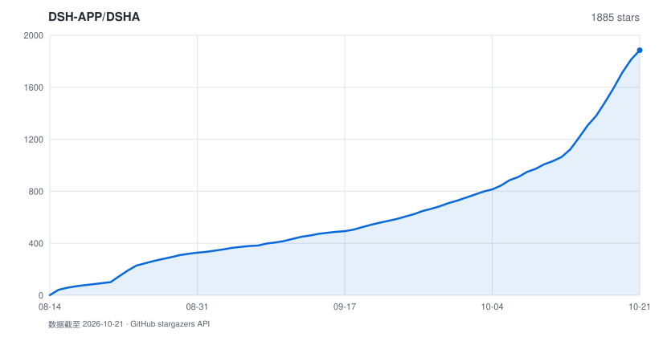

# DSHA

<!-- bxroot-edition-20261104 -->
> **这是 DSHA 的 bxroot 改版** — 源码 `0.2.1-rc.3-bxroot.12-dsh0.2.1-rc.3`（build214），包名 **`dsh.android.bxroot`**，与上游 DSHA 可并排安装、数据互相独立。
>
> 相对上游 build204 的差别：把容器运行时换成 [bxroot](https://github.com/qiannianhuanxiang/bxroot)（`LD_PRELOAD` 用户态路径翻译，不走 `ptrace`），并加上原生调用、冷启动解压与启动加速、Termux 路径兼容。默认运行时仍是 proot，bxroot 需在「配置 → 运行引擎」里显式选择。
>
> 本仓库只提供 bxroot 改版的源码与 APK；上游 DSHA 的源码与发布在 [DSH-APP/DSHA](https://github.com/DSH-APP/DSHA)。下面各节中标注 build204 及更早的测试、安装和设备记录属于上游历史，**不能当作本改版的验收结果**。

<!-- upstream-current -->
> **上游当前源码：build204** — `0.2.1-rc.3-20261027.1149-dsh0.2.1-rc.3`。合入 Sunset-3090-Q 的终端、界面与移动插件更新，并修复虚拟屏 MCP 启动参数兼容；保留手机控制及本机/LAN 访问，电脑连接仍已撤下。此版本目前为源码合并，未生成或发布新 APK；手机验收继续暂停。[改动与验证范围](docs/source-updates/20261027-sunset-vscreen-merge.md)。

<p align="center">
  <b>DeepSeek Harness 安卓启动器</b><br>
  在手机上跑完整的 <a href="https://github.com/deepseek-ai/deepseek-harness">deepseek-harness</a> —— 免 ROOT，免 Termux，装完即用
</p>

<p align="center">
  <a href="LICENSE"></a>
  <a href="https://github.com/qiannianhuanxiang/DSHA-app/releases/latest"></a>
  <a href="https://github.com/qiannianhuanxiang/DSHA-app/stargazers"></a>
  
  
  <a href="https://afdian.com/a/dsha_apk"></a>
  <a href="https://qm.qq.com/q/N5aZSlnmgM"></a>
</p>

<p align="center">
  <a href="README.en.md">English</a> · <b>简体中文</b> · <a href="https://dsha.cc">官网 dsha.cc</a> · <a href="CHANGELOG.md">更新记录</a> · <a href="docs/security-model.md">安全模型</a> · <a href="AGENTS.md">AGENTS.md（给 AI / 开发者）</a>
</p>

> 🤖 下一个 AI / 开发者请先读 **[AGENTS.md](AGENTS.md)**（项目结构、启动契约、踩过的坑），不要先全库扫描。

## ❤️ 赞助商

<table>
<tr>
<td width="180"><a href="https://zdxjl.com/register?aff=WDYTNDJ5LT4X"></a></td>
<td>感谢 <a href="https://zdxjl.com/register?aff=WDYTNDJ5LT4X">绿萝中转站</a> 赞助本项目！绿萝中转站是一个包含多种厂家模型的 AI 平台，多款主流大模型随开随用，写代码、生成图片等等都能在同一平台调用。国内外模型应有尽有，上新及时，服务周到，价格美丽。使用本链接注册可享受充值 105% 优惠。</td>
</tr>
</table>

<table>
<tr>
<td width="180"><a href="https://ai.onyxaxis.org/"></a></td>
<td>感谢 <a href="https://ai.onyxaxis.org/">Axis AI</a> 赞助本项目！Axis AI 是一个免费的公益 AI 平台，多款主流大模型随开随用，聊天、写代码、生成图片都能在同一平台内实现。</td>
</tr>
</table>

---

## 这是什么

DeepSeek Harness（`@deepseek-ai/dsh`）是 DeepSeek 官方的 agent harness，类 Claude Code。
它是为 glibc Linux 写的，直接在安卓上跑会撞上一堆事：原生模块编译不过、`link(2)` 被
SELinux 挡住、沙箱起不来、前端按桌面布局排版。

**DSHA 把这些全部封在一个 APK 里。** 首次完成离线环境初始化与必要核验后进入Main，Web在后台启动；
打开Web UI后再设置模型和API Key。不需要Termux、ROOT或命令行。里面是完整的Ubuntu环境：`apt`能用、
交互式 PTY 能用、需要编译的原生模块能装，跟你在服务器上用是同一套东西。

**本仓库是 bxroot 改版**，由 [@qiannianhuanxiang](https://github.com/qiannianhuanxiang) 维护；上游 DSHA 由
[@ym2025szz](https://github.com/ym2025szz) 维护。改版只换容器运行时并加优化，界面与功能沿用上游。

---

## 下载与交付状态

当前版本 **build214 / `0.2.1-rc.3-bxroot.12-dsh0.2.1-rc.3`**，包名 **`dsh.android.bxroot`**，与上游 DSHA 及旧 `com.dsh.client` 均可并排安装，数据与系统权限独立。

| 项 | 值 |
|---|---|
| 版本码 / 版本名 | `214` / `0.2.1-rc.3-bxroot.12-dsh0.2.1-rc.3` |
| APK | 299,134,179 字节 |
| SHA-256 | `a3fbdf448bc6a002f507f0b81949dfcb49025b3af169156a1aa27eb026b27310` |
| 签名 | v3，`dsha-bxroot`（自签名，不是上游 E7E3） |
| 平台 | Android 11+ / arm64-v8a / 系统 WebView |

从 [本仓库 Releases](https://github.com/qiannianhuanxiang/DSHA-app/releases) 下载。**签名与上游不同，不能覆盖安装上游 DSHA**，只能并排安装。

### 与上游的差别

- **容器运行时**：内置 [bxroot](https://github.com/qiannianhuanxiang/bxroot) v0.2.5（`LD_PRELOAD` 用户态路径翻译）。默认仍是 proot；bxroot 在「配置 → 运行引擎」里显式选择。
- **冷启动与解压**：延迟 syncfs、工具准备结果持久化缓存、Node 编译缓存、跳过无标记的旧版插件迁移。
- **原生调用**：`bx-host` 进 Android bionic world、`libbxroot-enter.so` 回入口。
- **Termux 路径兼容**：写死 Termux 前缀的脚本可以直接跑。

### 验证范围（如实）

- 宿主单测：构建脚本选定的 114 项，零失败。
- 原生库：`check-bxroot-native.py --apk` 逐字节核对 5 个库与 ELF 段对齐。
- 签名 / 对齐：v3 签名校验与 zipalign 校验通过。
- 真机：vivo V2352A / Android 16 上验证过安装、启动、bxroot 引擎下的 Termux shebang 脚本与 `pwd -P`。
- **未验证**：seccomp 兜底层（默认关）、真 Go 二进制、冷启动加速的实际提速幅度。

### 开始使用

1. 安装对应签名APK，首次启动解压并校验内置离线环境。
2. 环境初始化及必要核验完成后进入Main，Web在后台启动；Main显示进度和结果，不再先经过原生模型配置向导。
3. Web就绪后进入Web UI，在网页设置中配置提供商、模型与API Key。首次启动页及原生接口配置页不提供这些编辑入口。

文件提取/提交、环境试运行、正式Web鉴权、网页壳与核心功能可用分别计时；文件提交不代表完整初始化结束。当前样本与未完成对照见[性能调查](docs/performance-startup-20261022.md)。失败时在Main查看诊断，不以界面跳转代替就绪证明。

旧原生API Key临时不可读时保留记录并提示警告，仍可进入Web配置；不会把不可读等同为空值或静默替换。

---

## 为什么是 DSHA

|  | 说明 |
|---|---|
| 🚫 **零命令行门槛** | 内置离线 Ubuntu rootfs，APK 装完就能用。不装 Termux、不配 pkg、不敲命令 |
| 🐧 **完整 glibc 环境** | 不是裁剪版：`apt` / PTY / 原生模块 / Python / git 都在。插件仍需符合Linux arm64/glibc依赖及本机能力边界 |
| ⚙️ **三运行时选择** | 默认proot，可选 proroot 或 bxroot；实际性能取决于设备、I/O、缓存和插件，不以历史异条件样本给引擎排名 |
| 🔌 **手机就是 agent 的手** | 无障碍 + ADB 免 Shizuku 直连 + 独立虚拟屏：读屏、点按、装应用、跑自动化，全部内置 |
| 💾 **导出后迁移数据** | “数据与备份”导出无需密码的 `.tar.gz`；数据位置可在存储指南查看，本机副本不保证卸载后存续 |
| 🩺 **坏了能自己说清哪坏了** | 组件级自检 + 按需修补 + 启动诊断 + 独立应急 DSH；展示启动阶段以及核心或插件诊断，不把所有核心错误归为插件 |

---

## 核心模块

### ① 装机与环境

| 能力 | 说明 |
|---|---|
| 内置离线 rootfs | Ubuntu 24.04 (noble) arm64 打进 APK，无网也能完成环境部署 |
| 六步组件检查 | Linux 环境 → 基础工具 → Node.js → pnpm → dsh → 运行补丁；先检查，按需修复允许修补的失败项并复验。已有环境、Node 和 dsh 的替换须走保数据维护，详见[安装与维护](docs/install-and-maintenance.md) |
| 分步重装 / 更新 | rootfs、工具、Node、harness 相互独立，可单独重装，不重复下载 |
| 双装机路径 | 预构建包与源码构建都支持，源码路径自动处理 node-pty 等原生模块编译 |
| 离线工具链 | curl / git / Python / 证书随包锁定版本（`packages.lock.json`），不依赖用户先跑 `apt` |
| 镜像与网络 | apt 源官方 / 中科大镜像自动回退；DNS 三模式（auto / ipv4 / native，作用层见专页），AAAA 被拒时仅重试解析、不重放 HTTP 请求 |
| 基础环境版本化 | Ubuntu 基础环境独立编号；界面更新不重建环境，普通 dsh 更新不递增基础版本 |

DNS 设置中，`auto` 与 `ipv4` 都对特定 Node lookup 错误做窄重试；`ipv4` 另写受管 glibc `no-aaaa`，不等于关闭 IPv6 或控制所有解析器。`native` 退出该 Node 兼容路径，详见[DNS 专页](docs/dns-configuration.md)。build190 回到 build170 基座时恢复默认 proot，显式 proroot 仍可选择，历史与兼容细节见[运行引擎](docs/runtime-engines.md)。

### ② 运行时

| 能力 | 说明 |
|---|---|
| proot / proroot / bxroot 三运行时 | 默认稳定的 proot；可在“配置”选择 proroot 或 bxroot，实际兼容结果依机型 |
| 历史性能记录 | vivo V2352A / Android14 的旧构建曾记录特定基准提升；不代表当前默认引擎或本轮手机性能，见[运行引擎](docs/runtime-engines.md) |
| 有限兼容回退 | proroot 在鉴权前明确退出且无插件故障时，确认 guest 退出后仅重试一次 proot；慢启动不触发回退 |
| Node.js 24 + pnpm 10 | 与上游一致的运行环境，随包锁版本 |
| 分包更新 | Ubuntu 与 dsh 运行时在 APK 内分包；冷安装两份都解压，局部更新只读 dsh 包 |
| 受管更新试运行 | 新环境先在隔离区真实启动、验证端口 / 鉴权 / 会话读写 / 插件加载，全过后才切换提交，失败自动回切 |
| 前台服务与运行意图 | 通知栏显示状态，监督进程按当前运行意图协调；退出未知时保留屏障，不能承诺无条件自动重启 |
| 慢启动保护 | 等待鉴权不设强杀时限（60 秒仅提示），看门狗不会把慢启动当故障误杀 |

### ③ 数据与备份

| 能力 | 说明 |
|---|---|
| 数据位置与迁移 | “数据与备份 → 存储指南”查看实际位置；升级保留当前数据，卸载前请导出需要保留的内容 |
| v5 备份与导出 | 新导出为无需密码的 `.tar.gz` 完整性归档；内部自动副本仍加密，旧加密原件读取仍需原密码 |
| 自动备份计划 | 默认开启：每天指定时间 / 每隔 1–168 小时 / 停止 DSH 后，三种模式；运行中自动延后不打断工作；保留最近 3 份已验证副本 |
| 分范围备份 | 全量 / 只对话 / 只插件 / 只设置任选，恢复时只覆盖对应内容 |
| 换机恢复 | 导出实际对话、附件、设置及用户插件，先校验摘要和范围再预检恢复，保留当前内容与冲突原件 |
| 本机凭据与用户配置 | 桥 token 整文件排除；`.credentials.yaml` 字段级剔除本机密钥、保留用户 API key |
| 兼容旧备份 | 先完整认证/摘要核验再预检；未知或依赖不完整时如实提示。系统插件由当前 APK 重建，用户原件继续保留 |
| 会话损坏隔离 | 坏掉的会话文件挪到 `corrupt-backup` 可取回，不让一个坏文件卡住整个 Web |
| 覆盖更新自动清理 | 升级后闲时清理可再生缓存与多余旧副本；保留至少两份健康前代，改过的原件不动 |
| 保数据维护 | 完整格式化生产能力已退休；维护继续保留个人数据和未知原件 |

### ④ 设备能力（让 agent 真正操作这台手机）

agent 通过本机设备桥调用以下能力：优先 `127.0.0.1:3090`，占用时选择3091–3099，由本安装guest发现实际端口（token门控，`/app/help`有完整端点清单；[本轮验证范围](docs/releases/v0.2.1-rc.2-build191-sunset-merge-20261023.md)）：

| 能力 | 说明 |
|---|---|
| 屏幕操作 | **无障碍服务实现，不需要 ADB**：读屏结构化输出（带可点击区域坐标）、按文字 / 坐标点按、输入、按键、滑动、截屏存 PNG |
| 独立虚拟屏（实验） | Standard / Android 11+，先授权 ADB、Shizuku 或 Root 任一通道，再到虚拟屏页面创建屏幕；仅开启无障碍不会创建虚拟屏，详见[开启说明](docs/virtual-screen-guide.md) |
| ADB 无线直连 | 内置无线配对与连接管理，独立于 Shizuku；系统无线调试及授权有效时尝试连接，重启后可能需用户重新开启调试，见[权限文档](docs/device-permissions-architecture.md) |
| Shizuku / Root 通道 | 备用设备命令通道，与 ADB 同受命令白名单约束 |
| 与用户交互 | 系统通知、App 内提示、震动（长任务叫醒用户）、弹窗三选项征询、分享 / 打开链接 |
| 文件交换 | 读目录 / 文本文件、导出产物到 `Download/DSHA`；凭据区（`.dsh` / `.ssh` / `.android`）读写均被拒绝 |
| 传感器与位置 | 光线 / 加速度 / 陀螺仪 / 磁力计 / 气压 / 步数 / 定位 / 手电筒 —— 默认关闭，逐项授权 |
| 剪贴板 | 读写剪贴板（受系统前台限制） |
| 危险命令守门人 | 设备命令始终走白名单解析：格式化 / 分区 / SELinux / 系统属性等直接拒绝；不认识的命令不放行；拦截返回 `[POLICY_BLOCKED]` 而不是弹「仍然允许」 |
| 短信读取 | 独立敏感能力，仅限严格只读查询，默认每条确认，授权可撤销、不随备份迁移 |

### ⑤ 终端

| 能力 | 说明 |
|---|---|
| 真 PTY 终端 | Termux terminal-emulator JNI 实现：vim / htop / tmux 等全屏 TUI 可用 |
| 手机键盘补偿 | 扩展键行（Ctrl / Alt / Esc / 方向键 / Tab），双指缩放调字号 |
| 多标签 | 多会话并存，跨切页 / 旋转 / 语言切换保持进程与状态 |
| 简易终端兜底 | PTY 在个别机型异常时可切回简易终端，会话保留在后台 |

### ⑥ Web UI 与访问

| 能力 | 说明 |
|---|---|
| 双内核 | Standard 用系统 WebView；Low 内置 GeckoView 143，不受系统 WebView 版本拖累 |
| 移动端适配 | 内置 [dsh-web-mobile](https://github.com/mexiaosqwq/dsh-web-mobile) **3.2.2**（MIT），保留手机快捷键和窄屏适配，修复焦点、弹窗及插件卡片 |
| 画中画 | 默认关闭，用户主动开启后使用 PiP 小窗；正常返回与后台恢复保留同代网页实例 |
| 高刷与省电 | 按用户上限请求刷新率，空闲交还系统；实际帧率依设备和系统，不把请求成功当作性能证明 |
| 深浅色与多语言 | 深色 / 浅色 / 跟随系统；简体中文 / English，默认跟随系统语言 |
| 局域网访问 | 电脑 / 平板浏览器直接用手机上的 dsh。token 鉴权 fail-closed，命中后回设 `SameSite=Strict` Cookie，不让 token 随外链泄漏 |
| 老浏览器兼容 | 自动注入 `AbortSignal.any/timeout` 与 `crypto.randomUUID` polyfill（局域网 HTTP 下必需） |
| 流式悬浮条 | AI 输出像歌词一样贴在屏幕顶部，工具调用翻译成人话；底色 / 透明度 / 行数可调；危险命令可直接在悬浮条上批准 |
| Web 端口 | 默认自动分配，可显式手动指定；启动前选择可用端口，实际端口以鉴权启动信息为准。备用仅本机记忆、不随换机迁移；启动后绑定竞态不承诺自动重试，见[专页](docs/ports-and-networking.md) |

### ⑦ 插件生态

| 能力 | 说明 |
|---|---|
| 插件市场 | 安装 / 更新 / 启停 / 删除 / 搜索 / 排序，全在 App 内；配合官网 [dsha.cc](https://dsha.cc) 插件目录与社区插件 |
| 多样安装方式 | GitHub 简写 / tree / blob / archive / Release 链接、HTTPS 压缩包直链、本地导入（按内容识别格式）、终端 `dsha-plugin install` |
| 多下载源 | 自动择源，支持 npm 官方源与 npmmirror，更新检查多路并发、锁定版本复用缓存、失败有限回退 |
| 依赖与事务 | 随包 pnpm 10.34.5，允许未锁定依赖解析、生命周期脚本和 pnpmfile；记录实际锁与目录摘要，拒绝归档越界并保留回切原件 |
| 安装后自动启用 | 包格式、路径、依赖与摘要检查后自动提交并启用；用户主动禁用和安全模式意图保持，详见[插件说明](docs/plugins.md) |
| 硬依赖自动改造 | 插件写死的服务依赖就地改成运行时注入 —— 一个插件不拖挂整棵插件树 |
| 内置插件保护 | 内置插件不可删除；用户禁用过的，升级后保持禁用；配置可导入导出 |

主要内置插件包括：`dsh-web-mobile`（移动端适配）、`dsh-status-overlay`（悬浮条）、
`dsh-task-notifier`（回合完成通知）、`dsh-device-shell-guide`（设备能力引导）、
`dsh-computer-use-android`（Android Computer Use）、`dsh-tool-vscreen`（虚拟屏工具）、
`dsh-auto-review`（官方实验性 Auto review 入口）。

### ⑧ 可靠性与应急

| 能力 | 说明 |
|---|---|
| 安装与修复页 | 检查全部六项组件并按需修复（证书 / npm 异常、DNS、会话写入补丁等），只处理失败项 |
| 诊断报告 | 环境检查 + 失败日志可导出；启动诊断保存阶段、实际插件错误与退出码，最近五次脱敏留存 |
| 启动恢复 | 明确的启动 / 插件故障自动进入恢复页；安全启动用独立 profile 只加载官方基础组件，原配置与插件开关保留 |
| 配置快照 | 配置变更前自动留快照（三份健康 + 三份修复前），坏了能回滚 |
| 插件故障人话诊断 | Web 起不来时直接说「是插件 X、它要的服务不存在、点这里修」，而不是甩一屏 Node 堆栈 |
| 独立应急 DSH | 正式环境损坏时进入独立应急环境：独立运行根、只读诊断先行，写入修复需原生逐步确认 |
| 脚本增量热更新 | 关键脚本可从 GitHub 增量更新并**离线验签**（公钥内置，签名不符整批拒绝），不必等新 APK |

### ⑨ 安全（默认最小权限）

| 层面 | 做法 |
|---|---|
| 什么权限都不给也能用 | 最小配置（不给 ADB、不给文件权限、不开局域网）下 DSHA 照常跑 dsh；每项能力默认关闭、随时撤销 |
| 模型与API Key | 只在Web UI设置；原生页面不编辑，既有凭据不因入口退休自动清除 |
| 设备命令 | 白名单始终开启，Root / Shizuku / ADB 三通道同一套策略，应用停止前逐个核验归属，防 PID 复用误伤 |
| 桥凭据护栏 | `/app/export`、`/app/readfile` 拒绝凭据区路径，规范化 + canonical path 双重判定，堵住「软链接指凭据」的绕法 |
| 无遥测 | 不上传任何日志或使用数据；更新、插件下载、模型调用之外不发起网络请求 |
| 诚实披露 | 已知弱点（无内核级沙箱、历史明文备份、签名密钥待轮换等）在文档里直接列出 |

👉 每项权限到底暴露了什么、agent 碰得到手机的哪些部分，见 **[安全模型](docs/security-model.md)**。

---

## 与同类方案的关系

安卓上跑 dsh 目前有两条路，各有代价，说清楚比互相贴标签有用：

| | **容器派**（DSHA 走这条） | **Termux bootstrap 派** |
|---|---|---|
| 做法 | proot/proroot + 完整 glibc rootfs | 用 Termux 的包在 Android bionic 上裸跑 |
| 装机 | 装 APK 就完事 | 装 Termux → 敲命令 → 装工具链 |
| 环境 | 完整 Ubuntu，`apt` 与原生模块随便用 | 需要为 bionic 逐个打补丁 / 重编 |
| 开销 | 依引擎、文件I/O、缓存和设备实测 | 无同一容器层；仍需按相同工作负载实测 |
| 沙箱 | 两边都受限 | 两边都受限 |

---

## 已知限制

诚实列出来，省得你装完才发现：

| 项目 | 状态 | 说明 |
|---|---|---|
| 架构 | ⚠️ 仅 arm64-v8a | 32 位与 x86 设备不支持 |
| 系统 | ✅ Standard 11+ / Low 6+ | 老系统部分能力受系统限制（无线配对需 11+ 等，见 [android-low](docs/android-low.md)） |
| 包体 | ⚠️ 273.10 / 345.27 MiB | 内置完整 Ubuntu 环境的代价，换来的是免下载、免命令行 |
| bash 工具 | ✅ 可用 | 完整 Ubuntu 的 bash，agent 跑 shell 命令没有限制 |
| bash 的**沙箱隔离** | ⚠️ 不可用 | bubblewrap 需要 Android 未开放的 unprivileged user namespace。运行配置中的DSH权限档位选择已移除，普通DSH按 `danger-full-access` 运行；这不授予额外Android权限，也不构成对终端或第三方插件的强沙箱。屏幕操作确认与系统能力授权仍各自生效 |
| 卓易通 / 鸿蒙 anco | ❓ 未验证 | 理论可行，尚无真机回归 |
| 悬浮条 | ⚠️ 需要授权 | 用 `TYPE_APPLICATION_OVERLAY` 自绘；免 ROOT 拿不到真正的「状态栏歌词」接口 |
| 数据位置 | ⚠️ 需要文件权限 | 「所有文件访问」被拒时数据留在私有目录，卸载即丢（自检会明确告知当前状态） |

---

## 架构

```
┌──────────────────────── APK ────────────────────────┐
│ 原生 Android（Java 17 · Material3 · 单模块 :app）    │
│  ├ 启动 / 安装修复 / 配置 / 工作区 / 插件 / 终端     │
│  ├ 网页内核：系统 WebView（Standard）/ Gecko（Low）  │
│  ├ 前台服务 + 看门狗 + 通知 + 画中画                 │
│  ├ App 桥 :3090..3099（无障碍 / 虚拟屏 / 文件）      │
│  ├ LAN 代理 :3081 · ADB / Shizuku / Root 设备通道    │
│  └ 悬浮条（TYPE_APPLICATION_OVERLAY）                │
├─────────────────────────────────────────────────────┤
│ proot（默认）/ proroot / bxroot（可选，依机型兼容）  │
├─────────────────────────────────────────────────────┤
│ Ubuntu 24.04 arm64 · Node.js 24 · pnpm 10            │
│  └ @deepseek-ai/dsh  →  Web UI :<动态端口>           │
└─────────────────────────────────────────────────────┘
```

数据：实际位置以“数据与备份 → 存储指南”为准；旧 `Documents/dshdata` 数据继续兼容读取。
模型凭据由Web UI管理；本机数据、密钥与自动副本不保证卸载后存续。

---

## ADB 无线配对（设备 Shell 能力）

配好之后 agent 就能直接操作这台手机，**不需要 Shizuku**。

**首次配对（约 1 分钟）**

1. 系统设置 →「关于手机」→ 连点「版本号」7 次开启开发者选项
2. 开发者选项 → 打开「无线调试」
3. 进入「无线调试」→「使用配对码配对设备」，记下 **IP:端口** 与 **6 位配对码**
4. 回到 DSHA →「设备能力授权」页 → 填入 → 配对

> 无线调试的配对码需要 Android 11+；老系统可走 Shizuku / Root 通道，或直接用无障碍能力（读屏、点按、输入不需要任何配对）。

无线调试尚未开启时，“验证已有连接”可以先准备内置离线依赖；出现 `ADB_OFFLINE_READY` 仅表示依赖就绪。之后仍需打开无线调试并完成配对或连接验证。

**配对之后**：DSHA 自己维护连接（保活 + 重连），重启手机后也会自动恢复，不用再操作。

**验证**：内置终端里跑 `adb shell id`，输出 `uid=2000(shell)` 即成功。

**让 agent 用起来**：把技能包复制到 agent 的技能目录：

```bash
cp -r agent-skills/device-shell ~/.agents/skills/
cp -r agent-skills/screen-ocr-operator ~/.agents/skills/
```

`device-shell` 覆盖 ADB / Shizuku / Root 三通道的命令用法；
`screen-ocr-operator` 提供截屏 + OCR + 批量屏幕操作（无障碍读屏拿不到内容的 WebView / 游戏画面用）。

---

## 从源码编译

从新私有仓库的最终tag/完整commit或对应源码附件构建；不要把旧173检出当成本轮源码。需要JDK17、Node24、Python3.9+、Android SDK37和NDK26。先按[CONTRIBUTING.md](CONTRIBUTING.md)准备锁定资产，再参考[BUILD.md](BUILD.md)的工具链与签名配置。

```bash
python3 tools/run-host-tests.py --check-manifest
python3 tools/run-host-tests.py --stage fast
./gradlew :app:testStandardDebugUnitTest :app:testLowDebugUnitTest \
  :app:lintStandardRelease :app:lintLowRelease
./gradlew :app:assembleStandardRelease
```

Windows使用`gradlew.bat`。测试任务名中的Debug只表示测试变体，不要求生成或安装调试APK。正式包需既有E7E3签名凭据，并核对实际APK身份、资产、许可与摘要。Git检出不含大生成归档；完整打包使用Release源码ZIP内逐SHA核对的原始构建输入和现有recipe，无需另找独立bundle，也不能从APK逆还原全部输入。必要小型预编译依赖保留，但不承诺所有vendor native可从源码复现。私钥、用户数据、设备图或日志不进入交付。

本轮修改与验证边界见[性能调查](docs/performance-startup-20261022.md)，各阶段命令见[BUILD](BUILD.md)。完整源码ZIP的固定输入直接展开到项目路径，不嵌套输入包；最终文件清单、选定测试执行数、APK与ZIP摘要由统一交付回执绑定。F12及更早选择集、原始失败和文件数量保留在原报告，不当作本轮执行结果。

---

## 文档索引

完整导航见[文档总索引](docs/documentation-index.md)与[31主题缺口核对矩阵](docs/documentation-gap-matrix.md)。新增备份恢复、安装维护、更新、桥/文件、应急、诊断、插件权限、终端、PiP、语言及通知等专题；当前指南、历史说明和未分发本机证据分开标明。

| 文档 | 内容 |
|---|---|
| [AGENTS.md](AGENTS.md) | 项目结构、启动契约、技术约束与踩坑记录（AI / 新贡献者入口） |
| [docs/security-model.md](docs/security-model.md) | 安全模型：每项权限的边界与已知弱点（[英文版](docs/security-model.en.md)） |
| [docs/plugins.md](docs/plugins.md) | 插件安装与打包要求 |
| [CHANGELOG.md](CHANGELOG.md) | 完整更新记录 |
| [docs/ROADMAP.md](docs/ROADMAP.md) | 路线图与「明确不做」清单 |
| [docs/android-standard.md](docs/android-standard.md) / [android-low.md](docs/android-low.md) | 两版设备适配说明 |
| [docs/releases/](docs/releases/) | 各版本发布与验收记录 |

## 致谢

- [deepseek-ai/deepseek-harness](https://github.com/deepseek-ai/deepseek-harness) —— 本体
- [proot](https://github.com/termux/proot) / [proroot](https://github.com/coderredlab/proroot) / [bxroot](https://github.com/qiannianhuanxiang/bxroot) —— 免 ROOT 容器（见 [THIRD_PARTY_NOTICES.md](THIRD_PARTY_NOTICES.md)）
- [Termux terminal-view / terminal-emulator](https://github.com/termux/termux-app)（Apache-2.0）—— PTY 终端
- [dsh-web-mobile](https://github.com/mexiaosqwq/dsh-web-mobile) —— 内置移动端适配
- [Shizuku](https://shizuku.rikka.app/) —— 备用设备命令通道

## 交流

QQ 群 **975836806** —— 测试版、问题反馈、插件交流。

| 事宜 | 联系 |
|---|---|
| 项目主创（合作/授权/入伙） | QQ 2921185884 |
| 现维护者（项目提议/反馈，或直接提 issue） | QQ 1876843459 |
| Email | 1437ht@gmail.com |

## 许可

[MIT](LICENSE)。第三方组件许可见 [THIRD_PARTY_NOTICES.md](THIRD_PARTY_NOTICES.md)。

## Star History

本轮原仓库Star快照为1827（2026-10-21）；这是原仓库历史统计，不是当前私有仓库的Star数。

<a href="https://github.com/qiannianhuanxiang/DSHA-app/stargazers">
  <picture>
    <source media="(prefers-color-scheme: dark)" srcset="docs/star-history-dark.svg" />
    <source media="(prefers-color-scheme: light)" srcset="docs/star-history.svg" />
    
  </picture>
</a>

<sub>本源码包含 2026-10-21 核对的上游公开仓库静态快照及[聚合数据](docs/star-history.json)，只保存日期与数量。通过 [`tools/gen-star-history.py`](tools/gen-star-history.py) 设置 `STAR_REPO=DSH-APP/DSHA` 可手动重新生成；仓库现有工作流负责后续更新，实际执行状态以 Actions 为准。</sub>
